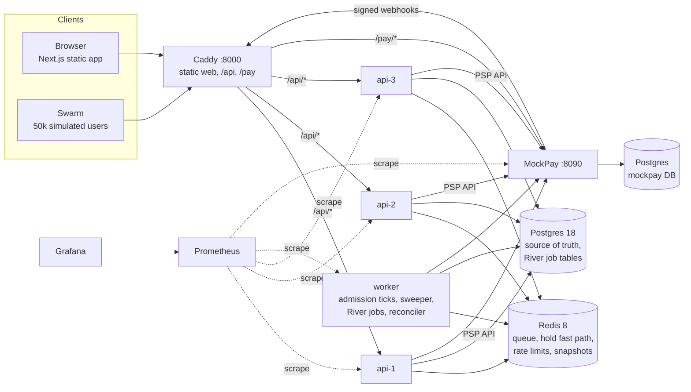

# SLUICE

[](https://github.com/sheshakanthra/sluice/actions/workflows/ci.yml)
[](https://github.com/sheshakanthra/sluice/actions/workflows/rush.yml)
[](LICENSE)

**A ticket booking system built for the minute everyone clicks at once.**
SLUICE puts a fair virtual waiting room in front of Lua-atomic TTL seat holds that Postgres fences, and runs payments that are idempotent at every hop.
The claim it has to prove on a public CI run: **50,000 concurrent users on 500 seats, 0 oversells, 0 duplicate charges.**

Go · PostgreSQL 18 · Redis 8 · River · Next.js (static export) · Caddy · Prometheus/Grafana · k6 · GitHub Actions. Every piece runs from Docker images, at ₹0.

---

## Results

> **Placeholder: filled in P8b from CI run `<URL>`.** The headline numbers come from one `rush` workflow run (scenario H, 50,000 users, 500 seats) on a GitHub-hosted `ubuntu-latest` runner, copied byte for byte from that run's `summary.json` and checked by `task verify:results`. No number appears here until that run exists.

| Metric (SPEC §5) | Value | Source |
|---|---|---|
| Users / seats | _filled in P8b_ | `summary.json` → `config` |
| Peak users in system | _filled in P8b_ | `load.peak_in_system` |
| Oversold seats | _filled in P8b_ | `audit.oversold` |
| Duplicate charges | _filled in P8b_ | `audit.duplicate_charges` |
| Orphan charges | _filled in P8b_ | `audit.orphan_charges` |
| Unresolved users | _filled in P8b_ | `outcomes.UNRESOLVED` |
| Checkout p95 | _filled in P8b_ | `latency_ms.checkout.p95` |
| Peak req/s | _filled in P8b_ | `load.peak_rps` |
| Runner, commit, run URL | _filled in P8b_ | `docs/results/RESULTS.md` |

### What the auditor caught on the laptop (not the headline)
These are **laptop runs** (Windows 11, Docker Desktop, swarm and stack on one machine), from [`docs/reports/P5b-rush.md`](docs/reports/P5b-rush.md) §4.1. They show the auditor is sensitive: take a guarantee away and it reports the damage. They aren't the CI numbers, and their latencies aren't SLO evidence.

| Run | What is switched off | Users | Oversold | Duplicate charges | Orphan charges | Unresolved | Audit exit |
|---|---|---|---|---|---|---|---|
| `p5b-b0` | waiting room, safe holds, idempotent payments (B0 naive) | 10,000 | **17** | **19** | 0 | 0 | 1 (fail, as expected) |
| `p5b-b1` | idempotent payments only (B1) | 10,000 | 0 | **27** | 0 | 0 | 1 (fail, as expected) |
| `p5b-b2` | waiting room only (B2 direct) | 10,000 | 0 | 0 | 0 | 0 | 0 |
| `p5b-smoke` | nothing (full design, SMOKE) | 5,000 | 0 | 0 | 0 | 0 | 0 |

Source: `docs/results/p5b/<run>/summary.json` (`audit.*`, `outcomes.UNRESOLVED`), all at commit `570aefc`. Commands: `task rush:b0 RUN_ID=p5b-b0`, `task rush:b1 RUN_ID=p5b-b1`, `task rush:b2 RUN_ID=p5b-b2`, `task rush:smoke RUN_ID=p5b-smoke`.

**Replay site:** _Vercel URL filled in P8b._ It replays a recorded run in Rush Control with no backend. Until P8b it replays the laptop run `p5b-smoke` and labels it "local". **Live demo:** on request. It runs on the laptop behind a Cloudflare Quick Tunnel (see [Live demo](#live-demo)).

---

## The problem
India's Tatkal train booking opens at 10:00 sharp. Tens of thousands of people hit "Book" in the same second for a few hundred seats. A naive system fails in three predictable ways: two people get the same seat, a retry or a slow bank charges someone twice, and the servers fall over, so everybody loses. SLUICE is built around making each of those impossible or bounded, and around **proving** it under load instead of asserting it.

## How it survives a rush
Four mechanisms, one per failure:

1. **The waiting room absorbs the stampede.** Each of 50k users joins with one cheap Redis call. Waiting users poll a status endpoint that needs **no Redis call at all**: a signed queue token plus an in-memory snapshot refreshed every 100 ms. Only a few hundred admitted users touch inventory at a time. Users who arrive before T0 are ordered by a **lottery**, so clicking fastest gives no edge.
2. **The Redis fast path sheds contention.** One Lua script holds seats all-or-nothing. Losers are rejected in microseconds without touching Postgres.
3. **Postgres is the source of truth.** Unique constraints and fenced conditional updates make an oversell impossible even when Redis is wrong, stale or wiped. Redis can always be rebuilt from Postgres.
4. **Payments are idempotent at every hop.** Client-to-API Idempotency-Keys, deterministic API-to-PSP keys, a webhook inbox, a transactional outbox, at most one live payment per order (a partial unique index) and a reconciler as the last safety net.



### The invariants
Unit tests, concurrency tests under `-race`, the auditor and the chaos suite all assert these ([`docs/ARCHITECTURE.md`](docs/ARCHITECTURE.md) §3).

| ID | Invariant | Enforced by |
|---|---|---|
| **I1** | **No oversell.** A seat has at most one ticket. | `tickets UNIQUE(event_id, seat_no)`, the `seats` state CHECK, and a conditional `UPDATE ... WHERE state='HELD' AND hold_id=$h`. Redis is advisory only. |
| **I2** | **No duplicate charge.** At most one live payment per order, and the PSP never sees two intents for one attempt. | Partial unique index `payments_one_live_per_order`, deterministic PSP keys, an order row lock and idempotent capture. |
| **I3** | **No orphan charge.** Every captured payment ends as a confirmed order or a refund. | Confirm and void paths, River retries and a reconciler every 30 s. |
| **I4** | **Per-user cap.** Tickets per (event, user) ≤ `max_per_user`. | `event_user_quota` CHECK inside the confirm transaction. |
| **I5** | **Holds expire.** An expired hold is reclaimed within 2 sweeper intervals and can never confirm afterwards. | The sweeper (PG first, then Redis) and `holds_expiry_idx`. |
| **I6** | **Fencing.** A confirm succeeds only if **every** seat is still `HELD` by that exact `hold_id`; a stale holder's authorization is voided. | A conditional seat update with row count == n, otherwise rollback and void. |
| **I7** | **Fair admission.** Offers go out in ticket order (lottery order for the pre-queue, then FIFO), nobody is admitted while sold out, and admitted-and-seeking users stay ≤ target. | The atomic `queue_tick.lua`, a monotonic cursor and the sold-out flag checked first. |
| **I8** | **Everyone gets an answer.** Every queued user reaches a terminal state, and "no" is a 2xx/409, never a 5xx. | Sold-out drain, offer expiry and rejoin, and an error budget. |
| **R1** | **Redis is rebuildable.** Losing every Redis key never breaks I1–I4. | `inventory_rebuild` and `queue_restore` from Postgres snapshots plus signed tokens; chaos case C1. |

---

## Run it locally
**Prerequisites:** Docker Desktop, Go (version in `go.mod`), Node 24, pnpm 11 and [Task](https://taskfile.dev) 3.54. Then run `pnpm --dir web install --frozen-lockfile` once.

### One command: the live demo stack
```bash
task demo
```
This generates `deploy/env/demo.env` with fresh random secrets (once, gitignored), builds the static web app, and starts the full stack: Postgres, Redis, 3 API replicas, the worker, MockPay, Caddy on :8000, Prometheus and Grafana. It also runs migrations and seeds the two demo events. Then open:

- http://localhost:8000/ for the app (book on **Quiet Tuesday**, which is always on sale)
- http://localhost:8000/control/ for Rush Control
- http://localhost:3001/ for Grafana (local only)

Stop it with `task stack:down ENV=demo` (volumes are kept).

### Dev loop (services on the host, hot rebuilds)
```bash
cp .env.example .env
task up          # Postgres, Redis, Prometheus, Grafana
task migrate     # goose + River migrations
task seed        # demo events: tatkal-chn-sbc and quiet-tuesday
task dev:api     # :8080      (each in its own terminal)
task dev:worker  # :9091
task dev:mockpay # :8090
task dev:web     # :3000
```
Quality gates: `task lint`, `task test` (integration tests use testcontainers against real Postgres 18 and Redis 8), `task test:race`, `task web:lint` and `task e2e` (Playwright E1–E5 with axe).

## Reproduce the rush
- **Canonical (CI):** GitHub → Actions → **rush** → *Run workflow*, scenario `H`, users `50000` (or `gh workflow run rush.yml -f scenario=H -f users=50000`). One `ubuntu-latest` runner brings up a fresh stack, runs the swarm and the auditor, and gates on [`loadtest/ci/verdict.py`](loadtest/ci/verdict.py): any invariant ≠ 0 or any unresolved user fails the run. Latency SLOs are reported but never gate. The artifact `rush-<run_id>` holds `summary.json`, `timeseries.csv`, the audit and the logs ([`docs/results/README.md`](docs/results/README.md) explains every field).
- **Laptop:** `task rush:smoke` (5k users) or `task rush` (50k), each followed by the audit. The baselines are `task rush:b0`, `task rush:b1` and `task rush:b2` (B0 and B1 are **expected** to fail the audit). Laptop latencies are noisy ([P7b report](docs/reports/P7b-hardening.md) §4), so CI is the number of record.
- **Chaos:** `task chaos` runs C1–C4, each a SMOKE-sized rush plus one fault and then the audit: C1 Redis `FLUSHALL` at T0+15 s, C2 an API replica killed at T0+10 s, C3 API→MockPay slowed (+2 s on 30% of connections) and timing out (5%) via Toxiproxy, C4 Postgres paused for 3 s ([ADR 0014](docs/adr/0014-chaos-suite-details.md)). On the laptop all four passed with 0 oversold, duplicate and orphan charges ([P7a report](docs/reports/P7a-hardening.md) §2).

## Live demo
`task demo`, then `task tunnel`. The tunnel runs `cloudflare/cloudflared` from its pinned Docker image on the compose network and prints an `https://<random>.trycloudflare.com` URL. It needs no account, and the only thing it can expose is the Caddy front door (web, `/api`, `/pay`). Everything is same-origin, so the hosted MockPay checkout and its return redirect work on whatever host the tunnel gets ([ADR 0016](docs/adr/0016-live-demo-path.md)). The demo profile refuses dev secrets and test endpoints, keeps rate limits on, and uses production TTLs. The "Start a demo rush" button (bots in the worker) is planned for P8b and hidden until it exists.

---

## Project structure
```
cmd/sluice/            one binary: api | worker | mockpay | migrate | seed | rush | audit | version
internal/
  queue/               waiting room: join, lottery, admission, status snapshot, restore
  inventory/           seat holds: Redis fast path + Postgres authority, sweeper, rebuild
  orders/  payments/   orders, PSP client, confirm/void/capture, webhooks, reconciler
  mockpay/             the PSP simulator (own DB, ledger, fault injection, hosted checkout)
  redisx/scripts/      every Lua script (embedded, each with a Go test)
  httpx/ auth/ ratelimit/ obs/ config/ app/   HTTP plumbing, tokens, GCRA limits, metrics, wiring
  rush/  audit/        the 50k-user swarm and the invariant auditor
db/                    migrations + sqlc queries (generated code in internal/db/gen)
web/                   Next.js static export (LIVE against the stack, REPLAY on a static host)
deploy/                compose files, env profiles, Caddyfile, Prometheus, Grafana
loadtest/              k6 cross-checks, chaos suite, CI verdict, matrix script
docs/                  SPEC, ARCHITECTURE, DATA-MODEL, API, LOADTEST, phases, reports, ADRs, results
```

## Key decisions
| Decision | ADR |
|---|---|
| Go, Postgres + Redis, River (Postgres job queue), Taskfile | [0001](docs/adr/0001-stack.md) |
| Hold path: quota placement, repair script, rebuild lock | [0006](docs/adr/0006-hold-path-details.md) |
| Payment path: reclaim settlement, late authorizations | [0007](docs/adr/0007-payment-path-details.md) |
| Queue scripts: lottery freeze rule, tick guards, rejoin | [0008](docs/adr/0008-queue-script-details.md) |
| Queue restore gate and rate limits (R1) | [0009](docs/adr/0009-queue-restore-and-rate-limits.md) |
| Stack containers, swarm, admission release and idle lease | [0010](docs/adr/0010-stack-containers-and-swarm-details.md) |
| Naive baselines and the auditor's counting rules | [0011](docs/adr/0011-baselines-and-auditor-details.md) |
| Readiness isolation and load shedding (the 20k cascade fix) | [0013](docs/adr/0013-readiness-and-load-shedding.md) |
| Chaos suite | [0014](docs/adr/0014-chaos-suite-details.md) |
| CI rush workflow and verdict gate | [0015](docs/adr/0015-ci-rush-workflow.md) |
| Live demo path: same-origin URLs, cloudflared in Docker | [0016](docs/adr/0016-live-demo-path.md) |

Interview notes: [`docs/INTERVIEW.md`](docs/INTERVIEW.md). Demo walkthrough: [`docs/DEMO-SCRIPT.md`](docs/DEMO-SCRIPT.md).

## Limitations (stated, not hidden)
- **One machine.** The headline run puts the whole stack and the 50k-user swarm on one shared-CPU CI runner. That proves correctness under concurrency, but it's not a capacity number for a real deployment.
- **MockPay, not a real PSP.** It simulates the failure modes that matter (timeout after commit, duplicate and reordered webhooks, declines) and keeps a ledger the auditor can read. Real PSPs have their own semantics (see INTERVIEW.md).
- **Laptop latency SLOs were missed.** Checkout p95 median was 1232.9 ms against a 250 ms target, the median of 3 interleaved SMOKE runs on a laptop where the swarm and the whole stack share one Docker VM ([P7b report](docs/reports/P7b-hardening.md) §4). CI is the canonical answer.
- **Lighthouse mobile Performance is 62–71**, not ≥ 90. Accessibility is 100 and Best Practices 96 ([P6b report](docs/reports/P6b-frontend.md) §4.2, with the cause and proposed fixes).
- **Direct mode (no waiting room) at 20k users** still ends with 4–7 users unresolved on the laptop. Correctness held (0 oversold, 0 duplicate charges), but the swarm was generator-bound ([P7a report](docs/reports/P7a-hardening.md) §3).
- **The demo rush** (bots started from the live demo) is not built yet (P8b).

## What changes at 10×
- Redis Cluster: every event key already shares the hash tag `{e:<id>}`, so per-event atomicity carries over.
- Read replicas or caching for availability bitmaps. Queue status is already lookup-free.
- More admission workers: they already work, because the tick is one atomic script.
- A CDN in front of the static app. The queue page is static assets.
- River queues partitioned per job kind. MockPay is already out of process.

## License
[MIT](LICENSE). All events, names and payments in the demo are fictional; MockPay moves no real money.
