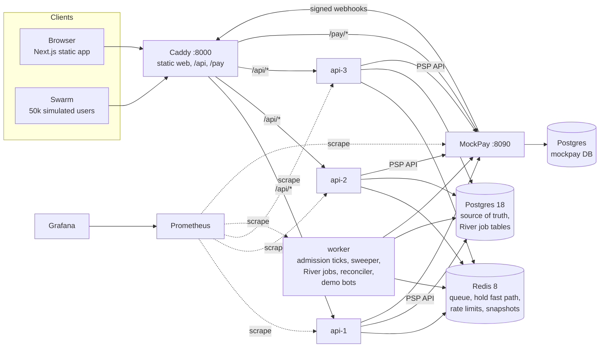
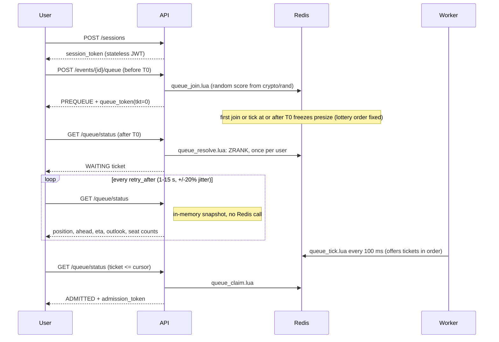
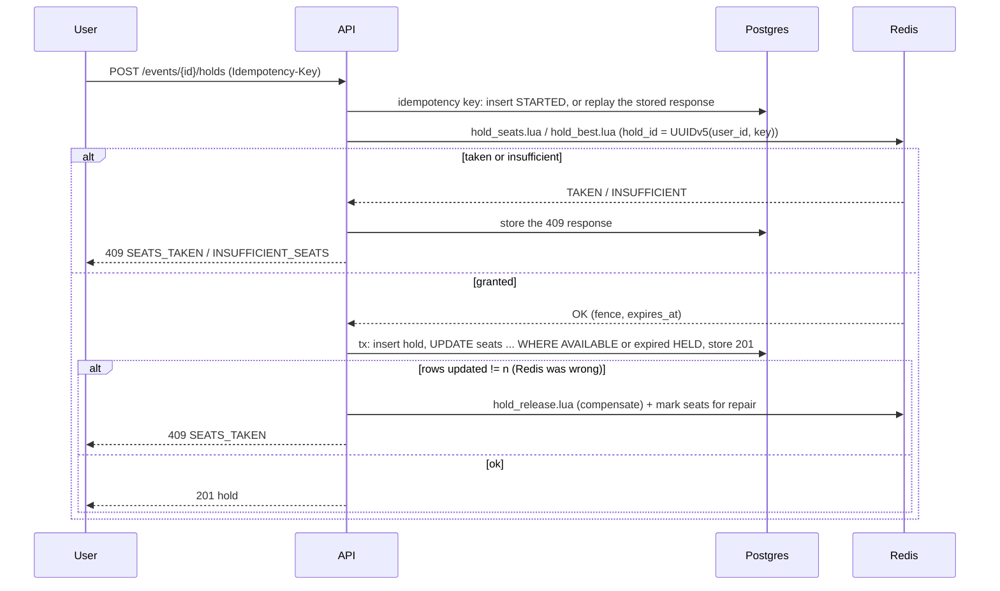

# ARCHITECTURE: SLUICE

## 1. Big picture



There's one Go binary, `sluice`, with subcommands `api`, `worker`, `mockpay`, `migrate`, `seed`, `rush`, `audit` and `version`. The web app is a static export: Caddy serves it as files, so it never touches the API servers.

## 2. Why this shape: four mechanisms
1. **The waiting room absorbs the stampede.** 50k users join with one cheap Redis call each. Polling status for waiting users needs **no Redis call at all**: a signed queue token plus an in-memory snapshot that refreshes every 100 ms. Only admitted users, a few hundred at a time, ever touch inventory.
2. **The Redis fast path sheds contention.** A single Lua script holds seats all-or-nothing, so losers are rejected in microseconds without touching Postgres.
3. **Postgres is the source of truth.** Constraints and conditional updates make an oversell impossible even if Redis is wrong, wiped or stale. Redis can always be rebuilt from Postgres (R1).
4. **Payments are idempotent at every hop.** Client → API keys, API → PSP deterministic keys, a webhook inbox, a transactional outbox, at most one live payment per order (enforced by the DB), and a reconciler as the final safety net.

## 3. Invariants (tests, the auditor and chaos runs all assert these)
| ID | Invariant | Enforced by |
|---|---|---|
| **I1** | **No oversell.** A seat has at most one ticket. | `tickets UNIQUE(event_id, seat_no)`; the `seats` state-shape CHECK; conditional `UPDATE ... WHERE state='HELD' AND hold_id=$h`. Redis is advisory only. |
| **I2** | **No duplicate charge.** At most one live (AUTHORIZED/CAPTURED) payment per order, and the PSP never sees two intents for one attempt. | Partial unique index `payments_one_live_per_order`; deterministic PSP keys; order row lock; idempotent capture. |
| **I3** | **No orphan charge.** Every captured payment ends as a confirmed order or a refund. | Confirm and void paths; River retries; reconciler every 30 s. |
| **I4** | **Per-user cap.** Tickets per (event, user) ≤ `max_per_user`. | `event_user_quota` CHECK, applied inside the confirm transaction. |
| **I5** | **Holds expire.** An expired hold becomes *reclaimable*. The sweeper reclaims it within 2 intervals (≤ 2 s). Once reclaimed it can never confirm. | Sweeper (PG first, then Redis); `holds_expiry_idx`. |
| **I6** | **Fencing.** A confirm succeeds only if **every** seat is still `HELD` by that exact `hold_id`. A late confirm from a stale holder fails and its authorization is voided. | Conditional seat update with row count == n, else rollback and void. |
| **I7** | **Fair admission.** Offers go out in ticket order (lottery order for the pre-queue, then FIFO). Nobody is admitted while sold out. Admitted-and-seeking users ≤ target. | Atomic `queue_tick.lua`; a monotonic cursor; the sold-out flag checked first. |
| **I8** | **Everyone gets an answer.** Every queued user reaches a terminal state, and "no" is always a 2xx/409, never a 5xx. | Sold-out drain; offer expiry and rejoin; error budget. |
| **R1** | **Redis is rebuildable.** Losing every Redis key never breaks I1–I4. Inventory is rebuilt from Postgres and queue state from `queue_snapshots` plus signed tokens. | `inventory_rebuild`, `queue_restore`; chaos C1. |

## 4. Flows

### 4.1 Join and wait


### 4.2 Hold seats


### 4.3 Order, pay, confirm, capture
```mermaid
sequenceDiagram
  participant U as User
  participant API
  participant PG as Postgres
  participant M as MockPay
  participant W as Worker
  U->>API: POST /orders {hold_id} (Idempotency-Key)
  API->>PG: tx: order PENDING_PAYMENT, hold PAYMENT_PENDING (+payment TTL), payment attempt 1
  API->>M: POST /v1/intents (key order:ID:attempt:1)
  API-->>U: order + checkout_url
  alt hosted checkout (UI)
    U->>M: pay on /pay/checkout/{intent}
    M-->>U: 303 back to the app
    U->>API: POST /orders/{id}/confirm
  else saved method (swarm, tests, quick-pay)
    U->>API: POST /orders/{id}/pay {payment_method}
    API->>M: POST /v1/intents/{id}/confirm (key confirm:INTENT)
  end
  M-->>API: webhook intent.authorized (signed; may be duplicated, late or out of order)
  API->>PG: tx: webhook inbox insert (dedupe) + enqueue process_webhook
  Note over API,W: /pay, /confirm and the webhook job all call ConfirmOrder (idempotent)
  API->>PG: ConfirmOrder tx: lock order, check every seat is HELD by hold_id, seats SOLD, tickets, quota, order CONFIRMED, enqueue capture_payment
  W->>M: POST /v1/intents/{id}/capture (key capture:INTENT)
```

**ConfirmOrder(orderID)** is the single convergence point, and it's idempotent:
1. Outside any transaction, read the order and the current attempt. If the payment isn't AUTHORIZED in our DB, `GET` the intent from MockPay. If it's still `requires_payment`, return PENDING. If it `failed`, mark the payment FAILED and return.
2. **Transaction A:** `SELECT order FOR UPDATE`. If already CONFIRMED, return it (replay). Under that lock, check whether another attempt of this order is already live. If one is, this authorization is a duplicate: enqueue `void_payment` for it, count `duplicate_charges_prevented_total`, and return the order. Otherwise mark this payment AUTHORIZED. The partial unique index is the backstop: a violation aborts the tx and the job retries into the "already live" branch. `SELECT hold FOR UPDATE`, which must be ACTIVE or PAYMENT_PENDING. Run `UPDATE seats SET state='SOLD', order_id=$o, hold_id=NULL, held_until=NULL, version=version+1 WHERE event_id=$e AND seat_no = ANY($s) AND state='HELD' AND hold_id=$h`; the row count must equal n. Insert the tickets, upsert `event_user_quota` (its CHECK enforces I4), set order → CONFIRMED and hold → CONSUMED, and insert `capture_payment` with River `InsertTx`. Commit.
3. If any check in A fails: roll back. **Transaction B:** order → FAILED (`HOLD_LOST` or `QUOTA_EXCEEDED`), hold → RELEASED if it's still ours, enqueue `void_payment`. The user sees "Payment cancelled: you were not charged."
4. After commit, best effort in Redis: `hold_consume.lua` (or `hold_release.lua`). The sweeper and reconciler repair any drift.

### 4.4 Expiry, and the late-payment race
- Each **sweeper** tick (every 1 s, in the worker, safe to run concurrently):
  1. `ZRANGEBYSCORE holds -inf now LIMIT 200` in Redis, plus `holds_expiry_idx` in PG for holds Redis doesn't know about.
  2. For each hold, run a PG tx: `UPDATE holds SET status='EXPIRED' WHERE id=$h AND status IN ('ACTIVE','PAYMENT_PENDING') AND expires_at < now()`. If 1 row changed, free its seats (`WHERE hold_id=$h AND state='HELD'`), expire its order if one exists, and enqueue `void_payment` if a payment was authorized.
  3. Then `hold_release.lua` in Redis. If PG says the hold was extended, use `hold_extend.lua`. If PG says it's consumed, use `hold_consume.lua`.
- **The race:** the authorization webhook lands just as the sweeper expires a PAYMENT_PENDING hold. Both run in PG transactions on the same rows. If the sweeper commits first, the hold is EXPIRED, ConfirmOrder's conditional update hits 0 rows, the payment is voided and the user wasn't charged. If confirm commits first, the hold is CONSUMED and the sweeper's conditional update hits 0 rows (no-op). Either outcome is correct, and a property test covers both orders.

### 4.5 Reconciliation (worker, every 30 s; the auditor can also trigger it)
- MockPay intents that are authorized or captured but whose order isn't CONFIRMED, older than 30 s → void (if authorized) or refund (if captured). Count `orphans_fixed_total`.
- CONFIRMED orders whose payment has been AUTHORIZED for more than 60 s → re-enqueue capture.
- PENDING_PAYMENT orders whose hold is gone → EXPIRED, plus void.
- Redis ↔ PG inventory diff → repair Redis from PG (log every fix with a metric).

## 5. Admission controller
Runs in the worker every `QUEUE_TICK` (100 ms) as **one atomic Lua script per event**. Several workers may run it at once without over-admitting.

```
queue_tick(now):
  if now < sale_opens_at: return PREQUEUE
  if presize not set: presize = ZCARD(pre)             # freeze the lottery (joins may also freeze it)
  ZREMRANGEBYSCORE offers -inf now                     # expired offers give their permits back
  ZREMRANGEBYSCORE active -inf now                     # expired shoppers leave
  if soldout: return SOLD_OUT
  avail = SCARD avail; held = ZCARD holds
  if avail == 0 and held == 0: SET soldout 1; return SOLD_OUT
  if avail == 0: return PAUSED                          # everything is held; wait for expiries
  seeking     = max(0, ZCARD active - SCARD holding)
  outstanding = ZCARD offers
  target      = min(QUEUE_MAX_ACTIVE, max(QUEUE_MIN_ADMIT, ceil(avail * QUEUE_OVERADMIT)))
  k = clamp(target - seeking - outstanding, 0, min(QUEUE_MAX_ADMIT_PER_TICK, presize + tail - cursor))
  for t in cursor+1 .. cursor+k: ZADD offers (now + OFFER_CLAIM_TTL) t
  INCRBY cursor k
  update admit_rate_ema; return ADMITTING(k)
```
Every second the worker also writes `queue_snapshots`, used by R1.

**Status math** (API, in memory):
- `position = ticket − cursor`
- `ahead = position − 1`
- `eta_s = position / max(admit_rate_ema, 1)`
- `retry_after = clamp(eta_s / 4, 1 s, 15 s) × U(0.8, 1.2)`
- PREQUEUE: `retry_after = clamp(time_to_T0 / 2, 0.5 s, 5 s)`. PAUSED: 5–10 s.
- **Outlook:** `remaining = avail + 0.25 × held`. LIKELY if `position ≤ remaining × OVERADMIT`, POSSIBLE if `≤ 3 ×` that, otherwise UNLIKELY.

## 6. Failure modes
| Failure | Effect | Why the invariants hold | Proven by |
|---|---|---|---|
| Redis wiped mid-rush | Queue and fast path lost | PG is authoritative (I1); inventory rebuilt from PG; queue restored from snapshot plus tokens | Chaos C1, rebuild tests |
| Redis down | Joins and holds fail fast with 503 + Retry-After | No writes reach PG without a Redis grant (`redis_pg` path); nothing is half-done | Integration test |
| Postgres paused 3 s | Holds and confirms slow or time out | Timeouts → retry with the same keys; idempotency replays | Chaos C4 |
| API replica dies mid-request | Some requests fail | Clients retry with the same Idempotency-Key; a STARTED key past `locked_until` is re-executable; deterministic hold_id | Chaos C2, idempotency tests |
| Worker down | No admissions, sweeps or captures for a while | State is durable; jobs resume; I3 is eventual (reconciler) | Integration test |
| PSP times out **after** committing | Client doesn't know the result | Retry uses the same key → same intent and result; capture is idempotent | MockPay fault `pm_timeout`, chaos C3 |
| PSP 5xx | Intent not created or not confirmed | River retries with backoff; the user can retry the same order (no new hold) | Payment tests |
| Webhook duplicated | Same event twice | Inbox PK (provider, event_id) dedupes | Payment tests |
| Webhook out of order (captured before authorized) | State regression risk | State transitions are monotonic; regressions are ignored | Property test |
| Webhook never arrives | Order stuck PENDING | Client `/confirm` pulls state; reconciler pulls MockPay | Payment tests |
| Double-click Pay (same key) | Two concurrent requests | Idempotency lock: the second gets 409 REQUEST_IN_PROGRESS or the replay | Race test |
| Rogue retry with a **new** key | Second pay attempt | One order per hold; deterministic PSP key per attempt; live-payment index | Swarm behaviour, payment tests |
| Hold expires during payment | Seats may be reclaimed | Confirm fences on hold_id; a stale confirm → void, "not charged" | Race property test |
| Two tabs, same user | Two holds or two queue entries | One active hold per user (partial unique index); join is idempotent per user | Unit and integration tests |
| Bots spam join | Queue pollution | Per-user idempotent join; GCRA per IP/user; lottery removes the speed edge | Rate-limit tests |
| Admission token replayed after purchase | Extra holds | Quota CHECK at confirm (I4); one active hold per user | Integration test |
| Offer not claimed | A permit is wasted | Offer expires after OFFER_CLAIM_TTL, its permit returns; user can rejoin (≤ 2) | Queue tests |
| Clock skew between nodes | Expiry disagreement | PG `now()` is the authority for holds; Redis TTLs are advisory | Design |

## 7. Decisions (ADR-lite; deviations go in `docs/adr/`)
| Decision | Why | Rejected |
|---|---|---|
| **Go** for every backend service and the swarm | Goroutines make 50k simulated users and thousands of connections cheap; a single static binary; the standard language for high-concurrency backends | FastAPI (GIL, heavier per connection), Node (fine, but weaker for the swarm) |
| **Postgres as the source of truth**, Redis as fast path and coordination | Constraints give *provable* I1/I2/I4; Redis gives speed and atomic Lua | Redis-only (unsafe if Redis is lost), PG-only (works behind the queue, but collapses in direct mode; kept as `HOLD_PATH=pg_only` for comparison) |
| **Lua scripts** for multi-key atomicity | One round trip, atomic, no retry loops | MULTI/WATCH (retry storms under contention), Redlock (wrong tool; we fence in PG) |
| **River** (Postgres job queue) for the outbox and jobs | Transactional enqueue in the same tx as the business write; retries, uniqueness and periodic jobs without another broker | Kafka/NATS (extra infra), hand-rolled outbox |
| **Polling** with server-advised `retry_after` | Cheap, cacheable, works through any proxy (Quick Tunnels don't support SSE) | SSE/WebSockets for 50k waiting users |
| **Stateless JWT (HS256)** with audiences session/queue/admission | Status polls need zero lookups; key ring allows rotation | Server sessions (a Redis hit per poll) |
| **Static-export web behind Caddy** | The waiting room is a static page on a CDN or a file server, which is how real waiting rooms scale | SSR for the queue page |
| **MockPay**, a purpose-built PSP simulator | Deterministic fault injection (timeout-after-commit, duplicate or reordered webhooks) and a ledger to audit duplicate charges | Razorpay test mode (needs an account; can't be load-tested or fault-injected) |
| **Custom Go swarm** plus k6 cross-check | 50k stateful users with dedicated connections on one machine (k6 VUs cost MBs each); k6 validates the numbers with an industry tool | k6 alone |
| **Taskfile** (go-task) | Cross-platform (Windows/Git Bash) with no make install | Make |

## 8. What changes at 10× (README "scaling" section)
- Redis Cluster: every event key already shares the hash tag `{e:<id>}`, so per-event atomicity carries over.
- Read replicas or caching for availability bitmaps; queue status is already lookup-free.
- Multiple admission workers already work, because the tick is atomic.
- A CDN in front of the static app; the queue page is ~100 KB of static assets.
- Partition River queues per job kind; move MockPay out of process (it's already out of process).
